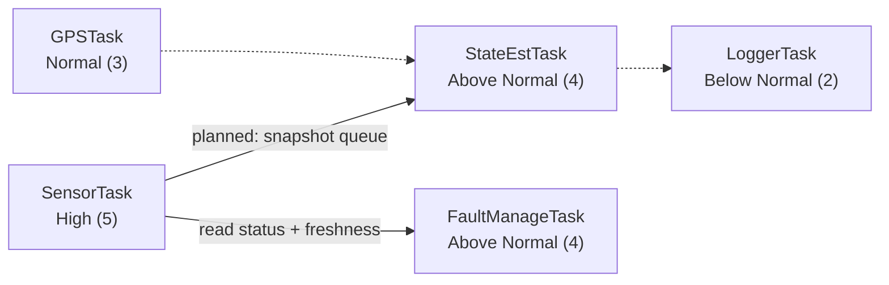

<div align="center">

# STM32 Real-Time Flight Computer

**A multi-sensor flight computer and future autopilot built on FreeRTOS and the STM32F446RE.**


[Overview](#overview) · [Hardware](#hardware) · [Architecture](#architecture) · [Status](#project-status) · [Roadmap](#roadmap) · [Build](#build--flash)

</div>

---

## Overview

This project is a sensor-based flight computer developed around real sensor data and bench validation. The firmware runs on FreeRTOS (CMSIS-RTOS v2) with preemptive scheduling, acquires data from an IMU, barometer, and magnetometer, and monitors sensor health at runtime through a dedicated fault-management task.

> **Development focus:** firmware correctness, real sensor data, and bench validation. This is a bench-rig project and is not battery-powered.

> **Status:** active development. This document describes what is implemented in the current source, not the target end-state.

---

## Hardware

| Component | Interface | Role |
|---|---|---|
| STM32F446RE (Nucleo) | — | Main controller |
| MPU9250 | SPI2 | 6-axis IMU (accelerometer + gyroscope) |
| BMP280 | SPI2 | Barometric pressure and temperature |
| MLX90393 | I2C1 | 3-axis magnetometer |
| STATE / FAULT push buttons | GPIO / EXTI | Bench-test harness for state and health transitions |
| Status, Normal, and Fault LEDs | GPIO | Health and state indication |

**Planned:** NEO-6M GPS (UART), MicroSD with FatFS, OLED display, ESP32-S3 telemetry bridge.

---

## Architecture

### Task Layout



| Task | Priority | Stack (words) | Status |
|---|---|---:|---|
| `SensorTask` | High (5) | 1024 | Sensor reads and UART debug output |
| `StateEstTask` | Above Normal (4) | 512 | Placeholder for the attitude estimator |
| `FaultManageTask` | Above Normal (4) | 256 | Runtime health monitoring and button handling |
| `GPSTask` | Normal (3) | 256 | Placeholder |
| `LoggerTask` | Below Normal (2) | 512 | Placeholder |
| `defaultTask` | Normal (3) | 128 | Sleeping placeholder |

One stack word is 4 bytes on Cortex-M4. The kernel uses `heap_4` with a 15,360-byte heap and a 1 kHz tick.

### Runtime Health Monitoring

`FaultManageTask` evaluates the read status and data freshness of every sensor and drives the health state machine.

| Rule | Behavior |
|---|---|
| Fault latch | 3 consecutive read failures |
| Fault clear | 10 consecutive successful reads |
| Stale data | Reading older than 500 ms |
| Critical sensor | MPU9250 (fault → `CRITICAL_FAULT`) |
| Noncritical sensors | BMP280, MLX90393 (fault → `FAULT`) |

### State Machines

**System state** (bench harness, advanced with the `STATE` button):

```
BOOTING → SELF_TEST → ACTIVE → BOOTING → ...
```

**Health state** (set by self-test, runtime monitoring, and the `FAULT` button for testing):

| State | Normal LED | Fault LED |
|---|---|---|
| `NORMAL` | On | Off |
| `FAULT` | Off | Steady |
| `CRITICAL_FAULT` | Off | Blinking |

Button events are processed in task context, not in the ISR.

### Startup Self-Test

At boot, each sensor is verified for communication, identity, initialization/configuration, and an initial read.

- Identity mismatch or bus failure → `CRITICAL_FAULT`
- Configuration or first-read failure → `FAULT`
- All checks pass → `NORMAL`

### Sensor Drivers

| Sensor | Capabilities |
|---|---|
| **BMP280** | Chip ID check, configuration, factory calibration load, raw reads, Bosch compensation (°C, Pa) |
| **MPU9250** | WHO_AM_I check, power, full-scale and DLPF configuration, 14-byte burst read (accel, temp, gyro) |
| **MLX90393** | Identification, configuration, raw measurement over I2C1 |

### Resource Monitoring

Task creation return values are checked, and free heap is verified after task creation. `SensorTask` reports free heap and per-task stack high-water marks over `USART2`.

---

## Project Status

| Area | State |
|---|---|
| CubeMX / HAL peripheral initialization | ✅ Implemented |
| FreeRTOS integration (CMSIS-RTOS v2) | ✅ Implemented |
| BMP280, MPU9250, MLX90393 drivers | ✅ Implemented, flashed, and confirmed working |
| Startup self-test | ✅ Implemented |
| Runtime fault management and resource reporting | 🔧 Implemented, **pending bench validation** |
| Sensor snapshot publication to estimator | ⏳ Not started |
| Attitude estimation | ⏳ Not started |

---

## Known Limitations

- **No snapshot mechanism.** `SensorTask` writes a global `sensor_data` structure with no consistent read path for other tasks. A bounded queue is needed before the estimator is built.
- **Blocking debug I/O.** UART formatting and transmission run inside the high-priority acquisition path.
- **Non-fixed sampling rate.** The 20 ms MLX90393 conversion wait and blocking I/O affect the loop period.
- **Unverified magnetometer config.** MLX90393 registers are read back but not compared against the requested values.
- **Fault button scope.** The fault button tests health transitions only; it does not prove real read failures are detected.

---

## Roadmap

- [x] STM32 HAL and CubeMX initialization
- [x] FreeRTOS migration with task and heap checks
- [x] BMP280, MPU9250, and MLX90393 drivers
- [x] Startup self-test
- [x] Runtime health monitoring and LED indication
- [ ] Bench-validate runtime health and task-memory reporting
- [ ] Sensor snapshot publication from `SensorTask` to `StateEstTask`
- [ ] 9-DoF Mahony filter (MPU9250 + MLX90393)
- [ ] NEO-6M UART reception, NMEA parsing, fix validity, and GPS-loss detection
- [ ] MicroSD / FatFS logging through `LoggerTask`
- [ ] ESP32-S3 telemetry bridge and OLED support
- [ ] Flight state machine (replacing the bench harness)
- [ ] PID control and actuator safety interlocks, only after estimation and fault handling are validated on the bench rig

---

## Repository Structure

```
├── Core/       Application source: tasks, state machines, self-test, sensor drivers
├── Drivers/    STM32 HAL and custom peripheral code
└── README.md
```

---

## Build & Flash

1. Open the project in **STM32CubeIDE** (peripheral configuration is in the `.ioc` file via CubeMX).
2. Build the project.
3. Flash to an **STM32F446RE Nucleo** wired to the sensors and buttons listed in [Hardware](#hardware).
4. Open a serial terminal on `USART2` at the configured baud rate to view sensor readings, heap, and stack reports.

---

<div align="center">

Part of a broader embedded systems portfolio · [github.com/Sumed-Sreedhar](https://github.com/Sumed-Sreedhar)

</div>
