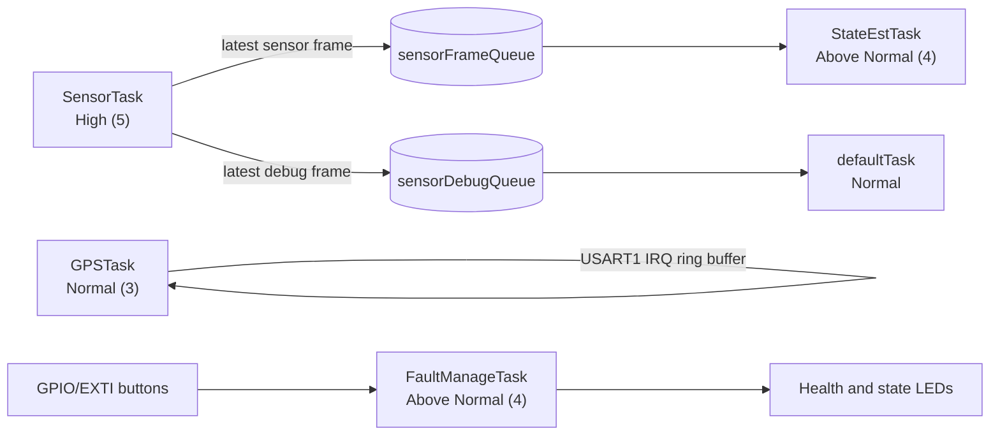

<div align="center">

# STM32 Real-Time Flight Computer

**A multi-sensor flight computer and future autopilot built on FreeRTOS and the STM32F446RE.**


[Overview](#overview) · [Hardware](#hardware) · [Architecture](#architecture) · [Status](#project-status) · [Roadmap](#roadmap) · [Build](#build--flash)

</div>

---

## Overview

This project is a sensor-based flight computer developed around real sensor data and bench validation. The firmware runs on FreeRTOS (CMSIS-RTOS v2) with preemptive scheduling, acquires data from an IMU, barometer, and magnetometer, and monitors sensor health through a dedicated fault-management task.

> **Development focus:** firmware correctness, real sensor data, and bench validation. This is a bench-rig project and is not battery-powered.

> **Status:** active development. Sensor acquisition and the current task framework are implemented. The attitude estimator and GPS path are present in code but still require bench validation; this is not flight-ready.

---

## Hardware

| Component | Interface | Role |
|---|---|---|
| STM32F446RE (Nucleo) | — | Main controller |
| MPU6500 | SPI2 | 6-axis IMU (accelerometer + gyroscope) |
| BMP280 | SPI2 | Barometric pressure and temperature |
| MLX90393 | I2C1 | 3-axis magnetometer |
| NEO-6M | USART1, PB6/PB7, 9600 baud | GPS position and fix data |
| STATE / FAULT push buttons | GPIO / EXTI | Bench state control and health indication test |
| Status, Normal, and Fault LEDs | GPIO | Health and state indication |

**Planned:** MicroSD with FatFS, OLED display, ESP32-S3 telemetry bridge, PID control, and actuator outputs.

---

## Architecture

### Task Layout



| Task | Priority | Stack (words) | Status |
|---|---|---:|---|
| `SensorTask` | High (5) | 1024 | Reads IMU at 100 Hz, barometer at 25 Hz, and magnetometer asynchronously; publishes latest frames |
| `StateEstTask` | Above Normal (4) | 512 | Runs the 9-axis Mahony filter and stores roll, pitch, and yaw |
| `FaultManageTask` | Above Normal (4) | 512 | Processes button events, monitors sensor health, and updates LEDs/state |
| `GPSTask` | Normal (3) | 512 | Parses GPGGA/GNGGA sentences from interrupt-fed USART1 receive buffer |
| `LoggerTask` | Below Normal (2) | 512 | Placeholder; logging is not implemented |
| `defaultTask` | Normal | 1024 | Prints one-second sensor and GPS diagnostic snapshots over USART2 |

One stack word is 4 bytes on Cortex-M4. `FreeRTOSConfig.h` currently sets a 32,768-byte heap and a 1 kHz tick. The `.ioc` task definitions should be kept aligned with the source when regenerating in CubeMX.

The capacity-one sensor queues intentionally retain the newest frame for estimation and diagnostics. They are not intended for lossless logging.

### Runtime Health Monitoring

`FaultManageTask` evaluates sensor read status and freshness and drives the health indication. A fault blinks the Fault LED while tasks continue running. GPS fix is currently diagnostic-only and does not raise a system fault.

| Rule | Behavior |
|---|---|
| Fault latch | 3 consecutive read failures |
| Fault clear | 10 consecutive successful reads |
| Stale data | Reading older than 500 ms |
| Critical sensor | MPU6500 (fault → `CRITICAL_FAULT`) |
| Noncritical sensors | BMP280 and MLX90393 (fault → `FAULT`) |
| GPS | Fix status shown in diagnostics; excluded from system fault escalation |

### State Machines

**System state** (bench harness, advanced with the state button):

```
BOOTING → SELF_TEST → READY → ARMED → FLIGHT → LANDING → SHUTDOWN
                         ↑                                │
                         └────────────────────────────────┘
```

The button cycles through the manual bench states. These states currently represent software state only; flight detection, actuator control, and transition safety logic are not implemented.

**Health state** (set by startup checks, runtime monitoring, and the FAULT button test):

| State | Normal LED | Fault LED |
|---|---|---|
| `NORMAL` | On | Off |
| `FAULT` | Off | Blinking |
| `CRITICAL_FAULT` | Off | Blinking |

Button events are processed in task context, not in the ISR.

### Startup Self-Test

At boot, each sensor is checked for communication, identity where supported, initialization/configuration, and an initial read.

- Identity mismatch or bus failure → `CRITICAL_FAULT`
- Configuration or first-read failure → `FAULT`
- All checks pass → startup check reports `PASS`

The startup banner reflects the startup checks; runtime health continues to update after the scheduler starts.

### Sensor Drivers and Estimation

| Sensor / module | Capabilities |
|---|---|
| **BMP280** | Chip ID check, configuration, factory calibration load, raw reads, Bosch compensation (°C, Pa) over SPI2 |
| **MPU6500** | WHO_AM_I check, power/full-scale/DLPF configuration, 14-byte burst read over SPI2 |
| **MLX90393** | I2C1 configuration/readback, asynchronous measurement scheduling, raw-to-field conversion |
| **NEO-6M** | Interrupt-driven USART1 receive, GPGGA/GNGGA parsing, fix/satellite/position/altitude reporting |
| **Mahony filter** | Gyroscope + accelerometer + magnetometer quaternion update and Euler-angle output |

### Resource Monitoring

Queue and task creation results are checked. The default task reports sensor data and GPS status on USART2 at 115200 baud. Stack-overflow checking and the malloc-failure hook are enabled in `FreeRTOSConfig.h`.

---

## Project Status

| Area | State |
|---|---|
| CubeMX / HAL peripheral initialization | ✅ Implemented |
| FreeRTOS integration, queues, and task framework | ✅ Implemented |
| BMP280, MPU6500, and MLX90393 drivers | ✅ Implemented; sensor communication has passed startup checks |
| Startup self-test | ✅ Implemented |
| Runtime health indication and manual state controls | 🔧 Implemented; bench validation ongoing |
| Sensor snapshot publication and multiline diagnostics | ✅ Implemented |
| Interrupt-driven NEO-6M receive and NMEA parsing | 🔧 Implemented; GPS fix validation pending |
| 9-axis Mahony filter | 🔧 Implemented; calibration, axis alignment, and static bench validation pending |
| SD/FatFS logging, telemetry, OLED, PID, actuators | ⏳ Not implemented |

---

## Known Limitations

- **Calibration and alignment are pending.** Accelerometer/gyro biases, magnetometer hard/soft-iron effects, and sensor-to-body axis alignment have not been validated.
- **Estimator output is not validated.** Do not use the reported attitude as a control input until static and controlled bench tests confirm stable behavior.
- **GPS fix is advisory.** The task reports fix status but no-fix does not currently raise a health fault.
- **Logger is a placeholder.** Latest-value queues discard old frames by design and are unsuitable for lossless recording.
- **Flight behavior is not implemented.** State names and button transitions are a manual bench harness; there are no PID loops or actuator outputs.
- **Regeneration needs care.** Keep USART1 interrupt configuration, task stack settings, and FreeRTOS heap settings aligned between CubeMX and generated source/configuration.

---

## Roadmap

- [x] STM32 HAL and CubeMX initialization
- [x] FreeRTOS task framework and latest-value sensor queues
- [x] BMP280, MPU6500, and MLX90393 drivers
- [x] Startup self-test and runtime health indication
- [x] Multiline raw and converted sensor diagnostics
- [x] USART1 interrupt-driven NEO-6M reception and NMEA GGA parsing
- [x] 9-axis Mahony filter implementation
- [x] Manual bench state controls
- [ ] Correct debug unit formatting and verify reported conversions
- [ ] Calibrate sensors and verify sensor-to-body axis mapping
- [ ] Validate Mahony attitude stability on a static bench rig, then through controlled rotations
- [ ] Verify GPS fix acquisition and stale-fix behavior outdoors
- [ ] MicroSD / FatFS logging through `LoggerTask`
- [ ] ESP32-S3 telemetry bridge and OLED support
- [ ] Flight-state transition conditions, PID control, and actuator safety interlocks after bench validation

---

## Repository Structure

```
├── Core/       Application source: tasks, state machines, self-test, sensor drivers
├── Drivers/    STM32 HAL and CMSIS device support
├── Middlewares/FreeRTOS kernel and CMSIS-RTOS v2 wrapper
└── README.md
```

---

## Build & Flash

1. Open the project in **STM32CubeIDE** (peripheral configuration is in the `.ioc` file via CubeMX).
2. Confirm USART1 is configured for the NEO-6M on PB6/PB7 at 9600 baud and its interrupt is enabled; retain USART2 on PA2/PA3 for the ST-Link serial terminal.
3. Keep the task stack values and 32,768-byte FreeRTOS heap aligned with `Core/Src/freertos.c` and `Core/Inc/FreeRTOSConfig.h` when regenerating.
4. Build the project.
5. Flash to an **STM32F446RE Nucleo** wired to the sensors and buttons listed in [Hardware](#hardware).
6. Open a serial terminal on `USART2` at 115200 baud to view sensor readings, attitude estimates, and GPS status.

---

<div align="center">

Part of a broader embedded systems portfolio · [github.com/Sumed-Sreedhar](https://github.com/Sumed-Sreedhar)

</div>
